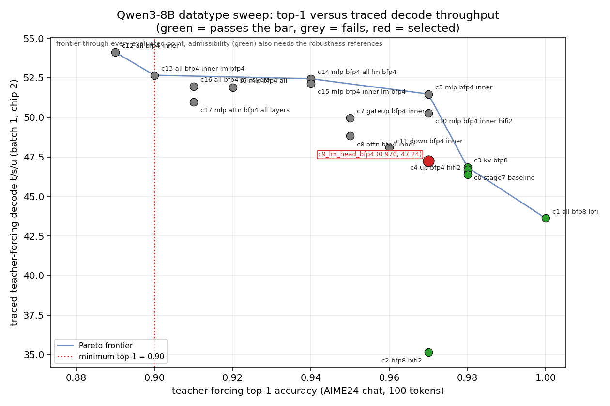
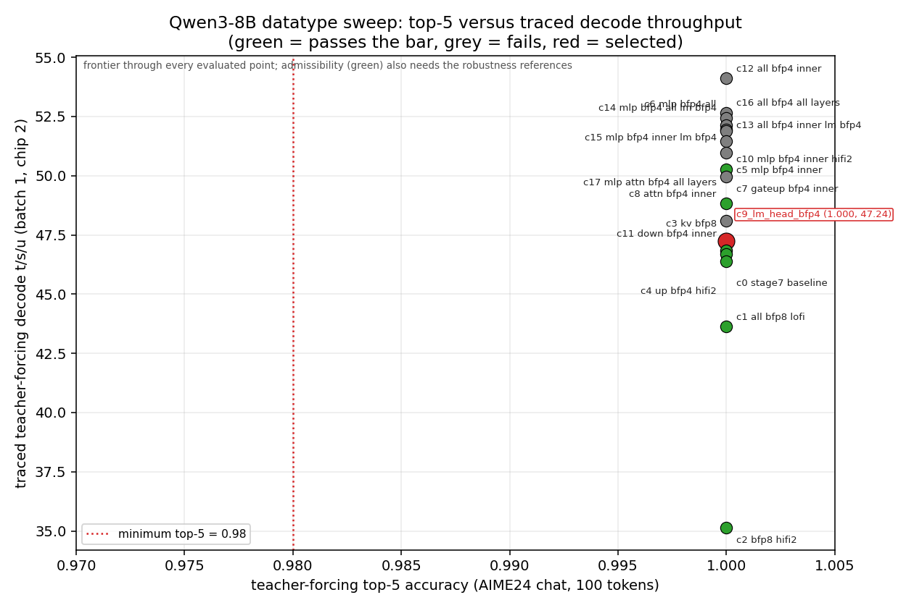

# Qwen3-8B datatype sweep

Status: selected `c9_lm_head_bfp4`, the stage-7 policy with a BFP4 LoFi LM
head, on one Blackhole P300 chip (chip 2 for every ranking run, 1x1 mesh,
p150 mesh graph descriptor; chips 0 and 1, released by the operator at
10:47 ET, for accuracy-only robustness runs). The selected policy is
consumed by default by `build_generator` through
`doc/datatype_sweep/selected_precision_config.json` (`tt/precision.py`),
proven by the 36-layer propagation check and the `tt-perf-report` rows of
the selected build. Stages 4 and 5 (multichip) were skipped by the
operator; one chip is the target topology, so there is no CCL dtype
(`ccl_dtype: null`). The large BFP4 MLP wins (up to +12 percent decode)
pass the readiness references but lose 7 to 10 points of top-1 against HF
on natural text and are rejected (section 3.4). Stage review: section 8.

Abbreviations: HF (Hugging Face), PCC (Pearson correlation coefficient), KV
(key/value), LM (language model), SDPA (scaled dot-product attention), DRAM
(device dynamic RAM), L1 (per-core local memory), BFP8/BFP4 (block floating
point, 8- and 4-bit mantissa), LoFi/HiFi2/HiFi4 (tt-metal math fidelity
levels), TTFT (time to first token), t/s/u (tokens per second per user),
CCL (collective communication library), PC (readiness prefill check), TF
(readiness teacher forcing), ET (Eastern Time).

## 1. Selected configuration and headline numbers

| Item | Value |
| --- | --- |
| Config | `c9_lm_head_bfp4` (`selected_precision_config.json`; candidate file `configs/c9_lm_head_bfp4.json`) |
| Change against stage 7 | LM head BFP8 -> BFP4 (decode LoFi bf16 acc, prefill LoFi fp32 acc instead of HiFi2 fp32 acc); everything else unchanged. Config schema: a weight group's `fidelity`, `fp32_acc`, `readers` and `in0_block_w` govern its DRAM-sharded decode matmul; prefill matmuls take their fidelity from the weight dtype (BF16 HiFi4, BFP8 `prefill.bfp8_fidelity`, BFP4 LoFi) with `prefill.fp32_acc` accumulation, so `c10` (HiFi2 on BFP4 MLP rows) reproduces `c5` to the digit on the prefill-path natural-text reference |
| Weight groups (decode, DRAM-sharded) | QKV BFP8 LoFi 1 reader; O BFP8 LoFi 1 reader; gate BFP8 LoFi 1 reader; up BFP4 LoFi 3 readers; down BFP8 LoFi 1 reader; `in0_block_w` 4 (down 6); bf16 accumulation, `packer_l1_acc` |
| Layer exceptions | none (all 36 layers share the policy; the config format supports per-layer exceptions and c5 to c17 used them) |
| Prefill fidelity | LoFi for BFP8 and BFP4 rows, fp32 accumulation; per-role kernel table `stage7`, gate/up row chosen by dtype |
| Norms, SDPA, RoPE, cache update | BF16, HiFi4, fp32 accumulation (unchanged) |
| Activations, residual stream | BF16 (L1 width-sharded decode residual over 32 cores, unchanged) |
| KV cache | BF16 paged, block 32 (BFP8 evaluated and rejected, 3.4) |
| Embedding | BF16 |
| LM head | BFP4 (padded vocab 152576 in 10 DRAM-width-sharded splits), decode LoFi, prefill LoFi fp32 acc, 1 reader (2 readers measured equal, 4 illegal), `in0_block_w` 4, padded-vocab mask in the last split |
| Logits and sampling | decode logits BF16 `[1, 1, 32, 152576]` into the common `SamplingGenerator` (BF16, top-k path, k = 1 for greedy); prefill logits fp32 (readiness paths) |
| CCL | none (one chip) |
| Acceptance thresholds | top-1 >= 0.90, top-5 >= 0.98 (skill defaults, no user bar), top-100 at the readiness expectation 1.000; applied to the main AIME24 reference and to every robustness reference a candidate was run on (second AIME24 prompt, 32-token short-prefix book prompt, 1468 natural-text positions) |
| Main reference, teacher forcing (traced decode, serialized) | top-1 0.970, top-5 1.000, top-100 1.000; TTFT 48.05 ms; 47.24 t/s/u (`readiness_c9_lm_head_bfp4_serial_chip2.json`; chain-1 row identical at 47.24) |
| Main reference, prefill check | top-1 0.980, top-5 1.000, top-100 1.000 (`readiness_c9_lm_head_bfp4_chip2.json`) |
| Second AIME24 prompt (chip 1) | PC 0.990 / 1.000 / 1.000; TF 0.990 / 1.000 / 1.000 (`readiness_c9_lm_head_bfp4_aime_p1_chip1.json`) |
| 32-token short-prefix book prompt (chip 0) | PC 0.950 / 0.990 / 1.000; TF 0.970 / 1.000 / 1.000 (`readiness_c9_lm_head_bfp4_book32_chip0.json`) |
| Natural text, 1468 positions against HF fp32 logits (chip 0) | top-1 0.9094, top-5 0.9980, PCC mean 0.9793 (`natural_text_c9_lm_head_bfp4_chip0.json`; baseline 0.9189 / 0.9980 / 0.9866). This reference goes through the prefill path (`prefill_logits`: LM head `minimal_matmul`, LoFi, fp32 accumulation); the decode LM-head kernel (DRAM-sharded, LoFi, bf16 accumulation) is covered on natural text by the 100-token book32 teacher forcing (0.970), the batch-32 same-input case and the AIME teacher-forcing rows |
| Stage-7 baseline, same runners, same day | TF top-1 0.980, top-5 1.000, top-100 1.000, TTFT 48.28 ms, 46.70 t/s/u; PC 0.990 / 1.000 / 1.000 |
| Gain | +1.2 percent traced teacher-forcing decode, TTFT -0.2 ms; LM-head weight bytes 0.66 -> 0.35 GB per token |
| Post-selection token-out, default path (section 5) | see the table there (`../full_model/perf_batch1_128_128.stage8.json`) |

Measurement regimes: "teacher forcing" is `readiness_check.run_teacher_forcing`
on the AIME24 chat-template reference (158-token prompt, 100 forced tokens,
batch 1, top-100 captured), decode t/s/u from host wall time between token
callbacks with the decode trace and the sampling trace replayed every step
(`runtime_counters` in each sidecar: 99 decode replays, 0 eager decode
steps, 0 seeded eager sampling steps). "Token-out" is `test_perf_batch1`
(128-token book prompt, 128 greedy tokens, one 128-byte token readback per
step). "Serialized" rows ran as the only device job on the host;
"concurrent" rows (round 2 on chip 2 while chips 0 and 1 ran accuracy jobs)
are 3 to 6 percent low and rank nothing; every contender was re-measured
serialized. "Natural text" is `logs/natural_text_check.py`: TT prefill
logits of the first 1500 book tokens against HF fp32 logits over positions
32 to 1499, top-1 and top-5 agreement with the HF argmax.

## 2. Pareto charts





Every point is one full-model candidate measured by traced teacher forcing
on chip 2 (main AIME24 reference on the x axis); the blue line is the
non-dominated frontier through every evaluated point, the red dotted line
the minimum allowed accuracy, the red point the selected config; green
points pass the bar on every reference they were run on, grey points fail
at least one. Reading: on the main reference the frontier runs from
`c1_all_bfp8_lofi` (1.000, 43.62) through the baseline (0.980, 46.70),
`c5` (0.970, 51.47), `c14` (0.940, 52.44) and `c13` (0.900, 52.66) to
`c12` (0.890, 54.11). Every point faster than the baseline family except
`c9` is grey: the BFP4-MLP family fails the natural-text reference (top-1
0.82 to 0.85 against the bar of 0.90) and the attention-BFP4 family fails
the short-prefix reference, so the frontier's fastest admissible point is
`c9` (0.970, 47.24), one step right of the baseline cluster. On top-5
every candidate scores 1.000 on the main reference, so that chart orders
by speed alone and the line at 0.98 is left of every point; the top-5 bar
bites only on the robustness references (`c16`, `c17` fall to 0.96 to
0.97 on the short prefix, the BFP4-MLP family to 0.975 to 0.987 on
natural text).

## 3. Candidate matrix and results

Full rows in `sweep_results.json` and `sweep_results.csv` (config id,
dtype and fidelity policy, top-1/5/100 on every reference, TTFT, traced TF
decode t/s/u, measurement regime, command, hardware, mesh, pass/fail,
sidecar paths). Readers for BFP4 rows follow stage 3 (QKV 3, O 2, gate 3,
up 3, down 2).

### 3.1 Chain 1 (serialized, chip 2, main reference)

| id | change against the baseline | PC top-1/5/100 | TF top-1/5/100 | TTFT ms | TF decode t/s/u | verdict |
| --- | --- | --- | --- | ---: | ---: | --- |
| c0_stage7_baseline | none | 0.990/1.000/1.000 | 0.980/1.000/1.000 | 48.28 | 46.70 | pass (baseline, equals stage 7) |
| c5_mlp_bfp4_inner | gate/up/down BFP4 LoFi, layers 1 to 34 | 0.940/1.000/1.000 | 0.970/1.000/1.000 | 45.55 (45.20 serial rerun) | 51.58 (51.47) | fail: natural text 0.830 |
| c6_mlp_bfp4_all | gate/up/down BFP4 LoFi, all layers | 0.940/1.000/1.000 | 0.920/1.000/1.000 | 45.42 (45.02) | 51.84 (51.89) | fail: natural text 0.834 |
| c7_gateup_bfp4_inner | gate/up BFP4 inner, down BFP8 | 0.970/1.000/1.000 | 0.950/1.000/1.000 | 46.88 | 49.96 | fail: natural text 0.847 |
| c11_down_bfp4_inner | down BFP4 inner (up BFP4, gate BFP8) | 0.960/1.000/1.000 | 0.960/1.000/1.000 | 47.00 | 48.09 | fail: natural text 0.891 |
| c8_attn_bfp4_inner | QKV/O BFP4 LoFi inner | 0.960/1.000/1.000 | 0.950/1.000/1.000 | 47.77 | 48.82 | fail: natural text 0.897 (aime_p1 0.970 / 0.970, book32 0.950 / 0.950 pass); every combination with it fails the short-prefix reference |
| c9_lm_head_bfp4 | LM head BFP4 LoFi | 0.980/1.000/1.000 | 0.970/1.000/1.000 | 48.02 (48.05 serial rerun) | 47.24 (47.24) | selected |
| c1_all_bfp8_lofi | up BFP8 (canonical conservative policy) | 1.000/1.000/1.000 | 1.000/1.000/1.000 | 50.21 | 43.62 | pass, slowest BFP8 policy, most accurate (rerun after the kernel-row fix, 3.5) |
| c2_bfp8_hifi2 | HiFi2 decode on the BFP8 rows | 0.990/1.000/1.000 | 0.970/1.000/1.000 | 48.30 | 35.15 | rejected: 25 percent slower, no accuracy gain |
| c4_up_bfp4_hifi2 | BFP4 up at HiFi2 | 0.990/1.000/1.000 | 0.980/1.000/1.000 | 48.26 | 46.38 | rejected: slower than LoFi at equal accuracy |
| c10_mlp_bfp4_inner_hifi2 | c5 with HiFi2 on the BFP4 MLP rows | 0.940/1.000/1.000 | 0.970/1.000/1.000 | 45.62 | 50.28 | fail: natural text 0.830, bit-identical to c5 because the natural-text reference runs the prefill path where BFP4 rows are LoFi whatever the decode fidelity (a cross-chip determinism control); the decode-path HiFi2 comparison is the teacher-forcing row (0.970 against c5's 0.970) and c10 is 2.5 percent slower |
| c3_kv_bfp8 | BFP8 KV cache | 0.990/1.000/1.000 | 0.980/1.000/1.000 | 48.42 | 46.84 | rejected (3.4) |

### 3.2 Rounds 2 to 4 (combinations, robustness references, reader variants)

| id | policy | main TF top-1/5 | aime_p1 PC / TF top-1 | book32 PC / TF top-1 | natural top-1 / top-5 | TF decode t/s/u | verdict |
| --- | --- | --- | --- | --- | --- | ---: | --- |
| c9_lm_head_bfp4 | baseline + BFP4 LM head | 0.970/1.000 | 0.990 / 0.990 | 0.950 / 0.970 | 0.909 / 0.998 | 47.24 serialized | selected |
| c18_lm_head_bfp4_readers2 | c9 with 2 LM-head readers | 0.970/1.000 (TF only) | | | | 47.17 serialized | no gain; readers 1 kept |
| c19_lm_head_bfp4_readers4 | c9 with 4 LM-head readers | | | | | error | `TT_FATAL num_workers_per_dram_bank must be in [1, 3]` (`matmul_utilities.cpp:345`), exact op-contract blocker |
| c14_mlp_bfp4_all_lm_bfp4 | c6 + BFP4 LM head | 0.940/1.000 (PC 0.960) | 0.920 / 0.900 | 0.910 / 0.910 | 0.826 / 0.975 | 52.44 serialized | fail: natural text |
| c15_mlp_bfp4_inner_lm_bfp4 | c5 + BFP4 LM head | 0.940/1.000 | 0.910 / 0.910 | 0.900 / 0.900 | 0.819 / 0.975 | 52.13 serialized | fail: natural text |
| c12_all_bfp4_inner | every projection BFP4 inner | 0.890/1.000 | 0.910 / 0.900 | not run | not run | 54.11 serialized | fail: main top-1 0.89 |
| c13_all_bfp4_inner_lm_bfp4 | c12 + BFP4 LM head | 0.900/1.000 | not run | 0.910 / 0.870 | not run | 52.66 concurrent | fail: book32 TF 0.87 |
| c17_mlp_attn_bfp4_all_layers | every projection BFP4, all layers | 0.910/1.000 | not run | 0.930 / 0.890 (top-5 0.96) | not run | 50.97 concurrent | fail: book32 |
| c16_all_bfp4_all_layers | c17 + BFP4 LM head | 0.910/1.000 | not run | 0.890 / 0.860 (top-5 0.96) | not run | 51.95 concurrent | fail: book32 |
| c0_stage7_baseline | | 0.980/1.000 | 0.990 / 0.980 | 0.970 / 0.970 | 0.919 / 0.998 | 46.70 | pass |
| c1_all_bfp8_lofi | | 1.000/1.000 | 1.000 / 1.000 | not run | 0.968 / 1.000 | 43.62 | pass |
| c3_kv_bfp8 | | 0.980/1.000 | not run | 0.970 / 0.960 (top-5 0.99) | not run | 46.84 | rejected (3.4) |
| c5, c6, c7, c11 | BFP4 MLP variants | 3.1 | 0.920 / 0.920, 0.920 / 0.910, not run, not run | 0.900 / 0.910, 0.920 / 0.920, not run, not run | 0.830, 0.834, 0.847, 0.891 | 3.1 | fail: natural text |

### 3.3 Compute-fidelity table per material matmul group

| Group (decode) | dtype | fidelity | traced TF decode t/s/u | accuracy (main TF top-1; natural top-1) | decision |
| --- | --- | --- | ---: | --- | --- |
| QKV, O (BFP8) | BFP8 | LoFi (c0) / HiFi2 (c2) | 46.70 / 35.15 | 0.980 / 0.970 | LoFi kept: HiFi2 25 percent slower, no gain |
| QKV, O (BFP4, inner) | BFP4 | LoFi (c8) | 48.82 | 0.950; natural 0.897 | rejected on natural text (0.897 < 0.90) and every combination fails the short-prefix reference; BFP4+HiFi2 not run because the group is out |
| gate, up, down (BFP4) | BFP4 | LoFi (c5) / HiFi2 (c10) | 51.58 / 50.28 | 0.970 / 0.970 (decode teacher forcing); natural 0.830 (prefill path, LoFi for both) | rejected on natural text; decode HiFi2 gives no accuracy at 2.5 percent cost, so LoFi between the two; the BFP4 weight quantization sets the loss (c1 against c0: 5 natural-text points for one BFP4 projection at equal LoFi fidelity) |
| gate (BFP4) alone, down (BFP4) alone | BFP4 | LoFi (c7, c11) | 49.96 / 48.09 | natural 0.847 / 0.891 | rejected on natural text |
| up alone (BFP4, baseline) | BFP4 | LoFi (c0) / HiFi2 (c4) | 46.70 / 46.38 | 0.980 / 0.980 | LoFi kept (selected) |
| LM head | BFP8 LoFi (c0) / BFP4 LoFi (c9) | LoFi | 46.70 / 47.24 | 0.980 / 0.970; natural 0.919 / 0.909 | BFP4 LoFi selected; BFP8 HiFi2 was rejected in stage 7 (2.26 against 1.50 ms); BFP4 HiFi2 not run (3.4) |
| norms, SDPA | BF16 | HiFi4 fp32 acc | | | unchanged, not swept (accuracy-sensitive, small share of the step) |

Every BFP4 group that was considered or selected has its BFP4+LoFi
candidate (c5 to c9, c11 to c17); BFP4+HiFi2 comparisons exist for the MLP
rows (c10) and the up row (c4), both slower at equal accuracy.

### 3.4 Rejected candidates with evidence

- BFP4 MLP family (c5, c6, c7, c10, c11, c14, c15): passes the readiness
  references (HF-greedy continuations, large margins) at 0.92 to 0.97
  top-1 but scores 0.82 to 0.89 top-1 and 0.975 to 0.993 top-5 against HF
  on 1468 natural-text positions where the baseline scores 0.919 / 0.998
  (`natural_text_*.json`, work log 7.1). The same loss shows in the resumed-
  prefill check: with c14 the two TT prefill paths fall to PCC 0.8793 at a
  position where both are far from HF (0.63 / 0.71), the continuation path
  no worse than the fresh one (`resume_margin_probe_L1500_s68_fp32.json`,
  work log 6.1); c5 and c15 fail the same gate
  (`../../readiness/prefill_resume_check_stage8_c{5,15}_*_default_thresholds.json`).
  Consistent with the stage-3 layer-17 delta PCC (0.9852 for BFP4 MLP
  against the 0.99 bar); the full-model readiness references alone would
  have passed it. Fallback for a caller that accepts the natural-text
  loss for +12 percent decode: `configs/c14_mlp_bfp4_all_lm_bfp4.json`
  through `QWEN3_PRECISION_CONFIG` (its full default-path evidence is kept
  under the `c14` tag: `readiness_c14_default_chip2.json`,
  `../full_model/*.stage8_c14.json`, `qualitative_c14/`, `profile_c14/`,
  `propagation_check_c14_36.json`, `batch32_same_input_c14_default_chip2.json`).
- Attention BFP4 (c8 and every combination c12, c13, c16, c17): c8 alone
  passes both AIME prompts and the short prefix but scores 0.897 on natural
  text (`natural_text_c8_attn_bfp4_inner_chip2.json`); c12 fails the main
  reference (0.89), the others fail the short-prefix reference (TF top-1
  0.86 to 0.89, top-5 down to 0.96). Consistent with the stage-3 layer-17
  delta PCC of 0.9737.
- BFP8 KV cache (c3): +0.3 percent at batch 1 (46.84 against 46.70 t/s/u,
  inside the 0.2 percent run-to-run noise), top-5 0.990 on the short-prefix
  reference against the baseline's 1.000, and the stage-3 per-user
  rejection (one 32-token-prefix user at PCC 0.9942 against HF). Operator
  cases: short prefix (`readiness_c3_kv_bfp8_book32_chip0.json`) and
  batch-32 same input (`batch32_same_input_c3_kv_bfp8_chip0.json`: 32 of 32
  users bit-equal to the solo arm, first divergence from HF greedy at token
  27, the same as the BF16 baseline). Capacity numbers kept in
  `context_contract.json` (`datatype_sweep.kv_candidates_evaluated`).
- HiFi2 anywhere (c2, c4, c10): slower at equal accuracy.
- All-BFP8 (c1): the most accurate policy (1.000 on both AIME prompts,
  0.968 on natural text) and the slowest BFP8 one (up BFP8 reads 25 MB
  more per token); recorded as the conservative alternative.
- LM head readers 2 (c18): 47.17 against 47.24, no gain; readers 4 (c19):
  illegal (`[1, 3]`). The BFP4 LM head at HiFi2 was not run: the three
  HiFi2 comparisons that were run all lost at equal accuracy, and the LM
  head is 0.35 GB of the 7.1 GB read per token.

### 3.5 Code changes made by the stage

- `tt/precision.py` (new): the precision config artifact, its loader
  (`QWEN3_PRECISION_CONFIG`, else `selected_precision_config.json`, else
  the built-in stage-7 baseline), per-layer policy construction with layer
  exceptions, terminal policy, KV dtype, and `describe_runtime` /
  `check_propagation` (read dtypes, fidelities and readers back from the
  live tensors, compute-kernel configs and program configs).
- `tt/generator.py`: `build_generator` consumes the config (logs one
  `precision config <id> from <path>` line), passes `layer_policies` and
  `kv_cache_dtype`, stores `generator.precision_config`; `teardown()` logs
  the runtime counters; `max_tokens_all_users(kv_cache_dtype=...)`.
- `tt/model.py`: `Qwen3Model(layer_policies=...)`, per-layer byte
  accounting, `kv_bytes_per_token(dtype)`.
- `tt/optimized_decoder.py`: `OptimizedPolicy.prefill_kernel(role, rows,
  dtype)` picks the gate/up table row by weight dtype (the BFP4-probed
  `up_proj` row at 512 rows overflows L1 with BFP8 tiles: c1's first run,
  `logs/c1_all_bfp8_lofi_prefill_check.log`). Under the selected policy the
  gate stays BFP8 and the up BFP4, so the rows are those of stage 7.
- `tests/test_full_model.py`: provenance records the config id, path and
  layer exceptions.
- `doc/datatype_sweep/configs/*.json`: every candidate; `selected_precision_config.json`.

## 4. Consumption proof

- `propagation_check_reduced.json` (chip 2, two real layers, four configs
  through `build_generator` with `QWEN3_PRECISION_CONFIG`): the live layer
  0 of `c5` reads back BFP8 gate/down (the exception) and layer 1 BFP4
  gate/up/down with readers 3/3/2; `c3` reads back `bfloat8_b` K and V
  caches; `c9` a BFP4 LM head; `c2` HiFi2 decode compute on QKV/O/gate/down
  and LoFi on up; `problems=[]` for all four.
- `propagation_check_selected_36.json` (section 5): the full 36-layer
  selected build (`logs/propagation_check.py` points `QWEN3_PRECISION_CONFIG`
  at `selected_precision_config.json` itself, the same file the default
  path resolves; the readiness pair and the pytest module of section 5 ran
  with no environment variable; rerun after review 1 with the extended
  check that also compares fp32 accumulation, `packer_l1_acc`,
  `in0_block_w`, prefill fidelity and norm/SDPA fidelity): BFP4
  LM head with LoFi decode and prefill compute, BFP8 LoFi QKV/O/gate/down,
  BFP4 LoFi up with 3 readers, HiFi4 norms and SDPA, BF16 caches,
  `problems=[]`. `propagation_check_c14_36.json` is the same check on the
  withdrawn c14 build (every layer BFP4 gate/up/down, `problems=[]`).
- Every readiness log carries the `precision config <id> from <path>` line
  (`precision_config_logged` in the sidecars) and the runtime counters.
- `profile/decode.txt` (section 5): the measured `tt-perf-report` rows of
  the selected build show `LoFi BF16 x BFP4` for the LM-head splits and the
  up row, `LoFi BF16 x BFP8` for QKV, O, gate and down. `profile_c14/decode.txt`
  shows the withdrawn build's BFP4 gate/up/down rows.
- The test provenance (`../full_model/*.stage8.json`) records
  `precision_config_id`, `precision_config_path` and `kv_cache_dtype`.

## 5. Post-selection evidence through the default construction path (chip 2, serialized)

All steps in `logs/post_selection_chip2.sh` (16:20 to 16:35 UTC, 12:20 to
12:35 ET), `selected_precision_config.json` = c9, no `QWEN3_PRECISION_CONFIG`
in the environment (every log shows `precision config c9_lm_head_bfp4 from
.../selected_precision_config.json`), chip 2 the only device job on the
host, commit `2e52cebf61` plus the stage's uncommitted tree (committed in
work log section 9).

| Check | Result | Artifact |
| --- | --- | --- |
| Readiness pair, default path | PC top-1 0.980 / top-5 1.000 / top-100 1.000; TF 0.970 / 1.000 / 1.000, TTFT 48.03 ms, 47.30 t/s/u (99 decode replays, 0 eager, 0 seeded eager sampling) | `readiness_selected_default_chip2.json`, `logs/selected_{prefill_check,teacher_forcing}.log` |
| Post-selection token-out (`test_perf_batch1`, 128-token book prompt, 128 greedy tokens, batch 1, traced decode and sampler, one token readback per step) | 20.776 ms/token = 48.13 t/s/u (best of 3: 20.776, 20.792, 20.787), TTFT 41.71 ms; teacher-forced on the same traces 20.80 ms/token; `sampler_traced` true; stage 7: 21.00 ms = 47.6 t/s/u, TTFT 42.1 ms | `../full_model/perf_batch1_128_128.stage8.json` (provenance `precision_config_id c9_lm_head_bfp4`, `kv_cache_dtype BFLOAT16`, chip 2) |
| Full-model module (36 layers) | 10 passed in 198 s: split-sampling trace, host work (64 tokens: 63 replays, 0 eager, repeat bit-equal), multi-row prefill rows 5, 31, 33, 127, 129, 257, 640, 1000 (PCC >= 0.99999 against solo, top-1 equal, rerun and reordered bit-equal), batch buckets 8/16/24/32 (every user equal to its solo arm, 31 replays, 0 captures), tracked replay workload (program cache 666 before and after the post-capture 3-row, 32-row, 8192-, 5000- and 12345-token work), seeded sampling | `../full_model/*.stage8.json`, `logs/selected_pytest_full_model_36.log` |
| 36-layer propagation check | `problems=[]`: one distinct layer policy (BFP8 QKV/O/gate/down, BFP4 up), BFP4 LM head with LoFi decode (bf16 acc, `packer_l1_acc`) and LoFi prefill (fp32 acc), BF16 K and V caches, fp32 prefill logits; 8 greedy tokens through the traced decode | `propagation_check_selected_36.json` |
| Qualitative suite (six chat prompts, 128 greedy tokens, HF control and stage-7 TT control) | every output a coherent English `<think>` answer on topic, 0.0 adjacent duplication, trigram repeat 0.02 to 0.10, no control tokens; first divergence from HF at 86, 37, 32, 39, 33, 22 (stage 7: 34, 37, 32, 35, 33, 22; equal or later on every prompt); from the stage-7 TT outputs at 34, 74, 92, 35, 79, 77 | `qualitative/{qualitative_prompt_format,rendered_prompts,hf_outputs,tt_outputs,tt_counters,tt_provenance,verdict}.json` |
| Resumed prefill, default thresholds (lengths 1500, 2560, 5000, 16384, block 32) | every PCC gate passes at all 16 starts (PCC minima 0.9970 at start 32 and 0.9886 at start 68, 0.9995 to 1.0000 elsewhere: identical to stage 7 because the decoder stack is unchanged); both controls fail at every 257-position window; top-1 agreement in the 257-position windows 0.988 to 0.992 (stage 7: 0.996) and in the hit windows 1472: 27 of 28 (stage 7: 28 of 28) and 16352: 31 of 32 (stage 7: 31 of 32), so `status=fail`; the two flips are probed against HF in `resume_margin_probe_c9_L1500_s1472_fp32.json` and `resume_margin_probe_c9_L16384_s16352_fp32.json` (chip 0, default path, 12:54 to 13:03 ET: 1472 window flips at position 1487, TT fresh-path margin 0.078, continuation margin 0.031, HF margin 0.641 with HF top-1 equal to the fresh path; 16352 window flips at 16369, margins 0.125 / 0.016 / 0.393; both TT paths agree with HF top-1 equally over the windows, 0.82 / 0.79 and 0.84 / 0.81, PCC ref against cand 0.9998 / 0.9995: near ties of the BFP4 LM head, not a cache or position fault); the lowered-threshold run (0.90 / 0.93, as stage 7) passes at all 16 starts | `../../readiness/prefill_resume_check_stage8_c9_lm_head_bfp4_default_thresholds.json` (chip 1), `prefill_resume_check_stage8_default_thresholds.json` (chip 2, default path, same rows), `prefill_resume_check_stage8_c9_lm_head_bfp4_lowered.json` (`status=pass`); the stage-7 canonical `prefill_resume_check.json` is untouched |
| Batch-32 same input (32-token book prompt, 100 greedy tokens) | 32 of 32 users bit-equal to the solo arm, one distinct output; first divergence from HF greedy at token 27 (the baseline's position too) | `batch32_same_input_selected_chip2.json` |
| Reduced-variant profile (one real layer, real terminal path, Tracy) | decode rows: QKV `LoFi BF16 x BFP8` 58 us, O 41, gate 114 (BFP8), up 70 (`LoFi BF16 x BFP4`), down 110 (BFP8); LM head 9 x `32 x 4096 x 16384` at 124 us plus `32 x 4096 x 5120` at 46 us, all `LoFi BF16 x BFP4` (stage 7: 150 us per split at BFP8 LoFi); the BFP4 LM-head rows are FLOP-bound (78 percent of peak, DRAM 53 percent), so a lower fidelity does not exist and readers 2 gave nothing (c18) | `profile/decode.txt`, `profile/prefill_128.txt`, `profile/*.csv` |

Terminal path per token after the change: LM head 9 x 124 + 46 = 1,162 us
against 1,400 us in stage 7 (0.24 ms of the 0.22 ms token-out gain; the
rest is noise).

## 6. Context contract

`doc/context_contract.json` `datatype_sweep` section: `current_supported_context`
40960 (unchanged, no capability reduction); BF16 cache, 147456 bytes per
token; resident weights 14.62 GB computed (decoder stack unchanged at
2 x 6.47 GB with the interleaved prefill copy, BFP4 LM head 0.35 GB
instead of 0.66 GB); all-users token budget 114432 (112320 before), two
full-context users (unchanged); batch 32 at full context still does not
fit (193 GB of cache against 34 GB of DRAM, the stage-6 hard limit).
`Qwen3Generator.max_tokens_all_users` gives 114432 for the selected model
without a mesh (resident bytes computed from the loaded dtype policy plus
the stage-6 allocator rounding), 112320 with neither model nor mesh (the
stage-6 constants), and the live free DRAM with a mesh (authoritative);
measured on chip 2 through the selected build in `token_budget_check.json`
(`logs/token_budget_check.py`, 12:58 ET): model-only 114432, no-model
112320, with the mesh 72736 after the generator's own 1280-block pool and
sampler state were allocated (20.77 GB allocated of 33.64 GB).
`kv_candidates_evaluated` records the rejected BFP8 cache (78336 bytes per
token, 211456 tokens, five users), the baseline and the withdrawn c14
(139008 tokens). Non-aligned prompt lengths: chunking, cache layout and
trace buffers are unchanged (BF16 cache, block 32, 4096-row chunks, the
same buckets) and the selected policy changes no decoder kernel; the
default-path module run covers rows 5, 31, 33, 127, 129, 257, 640 and 1000
and the resume check covers 1500, 2560, 5000 and 16384 with starts 32, 68
and the hit windows.

## 7. Limitations and open items

- The gain is small (+1.2 percent decode): the only reduced-precision
  step that keeps natural-text agreement above the bar. `c8` (attention
  BFP4, 48.82 t/s/u) misses that bar by 6 positions of 1468 (0.8965), less
  than one binomial standard deviation (about 11 positions), so its
  rejection is at the bar, not comfortable; a c8+HiFi2 run would not change
  it (the failing reference is the prefill path, whose BFP4 fidelity is
  fixed at LoFi) and c8+c9 would lower natural text by about one more point
  (c9 costs 0.919 -> 0.909). The BFP4 MLP
  family is 10 to 12 percent faster and 7 to 10 top-1 points worse on
  natural text; `configs/c14_mlp_bfp4_all_lm_bfp4.json` is the recorded
  fast fallback with its own default-path evidence.
- Natural-text margin of the selected config: 0.9094 against the 0.90 bar
  on 1468 positions (binomial standard deviation about 0.0075); the
  benchmark stage's lm-eval subsets are the next, independent sample.
- The natural-text reference was added after the first selection (c14) had
  already run its post-selection chain; the work log keeps both runs. The
  main AIME24 references rate the BFP4-MLP family 0.92 to 0.97 and do not
  see the natural-text loss; later stages should keep a natural-text
  agreement check beside the readiness references.
- Resumed prefill on the selected config: every PCC gate passes at the
  default thresholds; top-1 fails on two hit windows by one near-tie flip
  each (1472: 27 of 28; 16352: 31 of 32), the stage-7 failure class; the
  lowered-threshold run (0.90 / 0.93, as in stage 7) passes at all 16
  starts. The canonical `readiness/prefill_resume_check.json` from stage 7
  is untouched; stage 9 reruns the gate on this policy.
- The prefill kernel table is the stage-7 one; the BFP4 LM-head prefill
  (minimal_matmul, LoFi) was not re-probed.
- The BFP4 LM head at HiFi2 was not measured (3.4).
- Round-2 rows on chip 2 that overlapped chip-0/1 jobs are marked
  `concurrent` and were re-measured serially where they mattered.
- Teacher forcing measures batch 1; the batch-32 decode step was not
  re-timed. The BFP8 KV cache (c3) passes every reference it ran on and the
  operator's two cache cases; it is rejected on the batch-1 metric (no gain
  inside noise) plus the stage-3 per-user PCC, and its capacity advantage
  (211456 tokens, five full-context users against two) and batch-32 decode
  step are left to the vLLM stage to weigh.
- `c13`, `c16` and `c17` have no second-AIME-prompt row and `c2`, `c4`,
  `c12`, `c13`, `c16`, `c17` no natural-text row (already rejected on another
  reference, or slower than the baseline). Every candidate faster than the
  selected one has a recorded failing reference: c12 on the main reference,
  c13, c16 and c17 on the short prefix, and c5, c6, c7, c8, c10, c11, c14
  and c15 on natural text (each of those has a natural-text row).

## 8. Stage review

Review 1 (`logs/review/stage_review_1.md`, full text `stage_review_1_full.md`):
`more-work-needed`. P1: the committed results marked c8 and c10 `pass`
without robustness rows while c9 was selected (rows run during the review,
now recorded in 3.1, 3.2, 3.4 and work log 9.1). P2: the c9 hit-window
flips had no margin probe (run, section 5). P2: the context-contract note
against the runtime's no-mesh fallback, and the gitignored CSV (fixed:
`max_tokens_all_users` computes resident bytes from the loaded model, the
contract note says which path gives which number, `sweep_results.csv` and
`profile/*.csv` are force-added). Other concerns and hard-check gaps fixed:
natural-text scope note (section 1), fidelity schema note (section 1),
propagation wording (section 4), resume wording (section 5), resume sidecar
fields, chart single-point frontier, stale natural-text fields, extended
`check_propagation` (fp32 accumulation, `packer_l1_acc`, `in0_block_w`,
prefill fidelity, norm/SDPA fidelity; rerun on the 36-layer build), comment
lines removed from the helper scripts, c3 capacity note (section 7).
Review 2 (`logs/review/stage_review_2.md`, full text `stage_review_2_full.md`,
13:05 to 13:22 ET): `clean-pass`, no required work. Notes acted on after
the verdict (wording only, no evidence change): the acceptance-rule
sentence and this section's coverage sentence (section 7), the c10 = c5
inference (3.1, 3.3), `sweep_results.csv` gained the `chip`,
`timing_regime`, `measurement_regime`, `command`, `hardware` and `mesh`
columns, and the JSON key for the chain-1 row of a re-measured candidate
is `earlier_row`. Carried to stage 9 as notes: a
`TT_METAL_TRACE_ALLOC_TRACKING=1` run on the selected policy (stage 8
changes no capture code; stage 7's tracked run and the flat program cache
cover it), passing the generator's `kv_cache_dtype` to
`max_tokens_all_users` in the plugin hook, and asserting the embedding,
final-norm, activation and logits dtypes in `check_propagation` (reported
by `describe_runtime`, matching by inspection).

## 9. Reproduction

From the checkout root, every device command through
`doc/full_model/logs/stage_env.sh <chip> <command>` under `timeout`
(`PY` = `/home/hous/dev/tt-metal/python_env/bin/python` run with the
brief's environment, `M` = `models/autoports/qwen_qwen3_8b`, `D` =
`$M/doc/datatype_sweep`, `L` = `$D/logs`):

```bash
$PY $L/make_configs.py                                   # candidate configs
bash $L/sweep_chain_chip2.sh c0_stage7_baseline c9_lm_head_bfp4 ...          # readiness pair per candidate, chip 2
bash $L/sweep_chain.sh 1 bringup/references/qwen3_8b_aime24_chat_p1.refpt aime_p1 c9_lm_head_bfp4   # robustness reference on another chip
QWEN3_PRECISION_CONFIG=$D/configs/c9_lm_head_bfp4.json $PY $L/natural_text_check.py $D/natural_text_c9_lm_head_bfp4_chip0.json 1500 32
bash $L/serial_tf_chip2.sh c9_lm_head_bfp4 c18_lm_head_bfp4_readers2    # serialized re-measurement
$PY $L/collect_results.py c9_lm_head_bfp4                # sweep_results.{json,csv}, Pareto charts
$PY $L/write_selected.py c9_lm_head_bfp4                 # selected_precision_config.json
$PY $L/update_context_contract.py c9_lm_head_bfp4 c3_kv_bfp8 c0_stage7_baseline c14_mlp_bfp4_all_lm_bfp4
bash $L/post_selection_chip2.sh                          # default-path evidence (section 5)
```

## 10. Artifact index

- `sweep_results.json`, `sweep_results.csv`: every candidate with policy, numbers on every reference, regime, command, hardware, mesh, status.
- `selected_precision_config.json`: the consumed artifact; `configs/`: every candidate config.
- `top1_perf_pareto.png`, `top5_perf_pareto.png`.
- `readiness_<id>_chip2.json`: main-reference sidecars; `readiness_<id>_serial_chip2.json`: serialized re-measurements; `readiness_<id>_aime_p1_chip1.json`, `readiness_<id>_book32_chip{0,2}.json`: robustness references; `natural_text_<id>_chip<N>.json`: natural-text agreement; `readiness_selected_default_chip2.json`: the default-path readiness pair of the selected config; `readiness_c14_default_chip2.json`: the withdrawn c14's.
- `propagation_check_reduced.json`, `propagation_check_selected_36.json`, `propagation_check_c14_36.json`.
- `batch32_same_input_{c3_kv_bfp8,c0_stage7_baseline}_chip0.json`, `batch32_same_input_selected_chip2.json`, `batch32_same_input_c14_default_chip2.json`.
- `resume_margin_probe_c14_L*_fp32.json` (c14 attribution), `resume_margin_probe_c9_L*_fp32.json` (selected-config hit windows), `qualitative/` (selected), `qualitative_c14/`, `profile/` (selected), `profile_c14/`, `logs/` (chain scripts, status files and the review record are committed; `logs/*.log` command logs stay in the worktree because the repository ignores `*.log`, as in stage 7; `sweep_results.csv` and `profile/*.csv` are force-added past the `*.csv` ignore).
- `../context_contract.json` (`datatype_sweep` section), `../full_model/*.stage8.json` (selected) and `*.stage8_c14.json`, `../../readiness/prefill_resume_check_stage8_*.json`, `bringup/references/qwen3_8b_aime24_chat_p1.refpt` (committed), `bringup/references/qwen3_8b_book32.refpt` (1.5 MB, above the repository's 500 KB hook limit, not committed; regenerate with `logs/generate_reference_wrapper.py --hf-model Qwen/Qwen3-8B --prompt-source book --prompt-len 32 --gen-len 100 --top-k 100 --output bringup/references/qwen3_8b_book32.refpt`, see `logs/round2_chip2.sh` and `logs/generate_reference_book32.log`).
